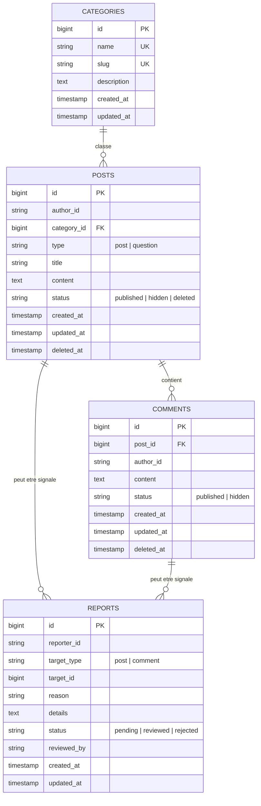

# ParentConnect - Microservice Community

Microservice **Community Service** de la plateforme **ParentConnect** (plateforme d'entraide entre parents d'un même quartier). Ce service est dédié au partage et à l'échange :
- Création de publications et questions thématiques
- Réponses et commentaires communautaires
- Gestion des catégories de discussion
- Signalements et modération par les administrateurs

---

## 1. Architecture et Principes Clés

- **Database per service** : Le service possède sa propre base **PostgreSQL** (`community_db`) et ne partage aucune table avec d'autres microservices.
- **Aucune dépendance utilisateur directe (Stateless User)** : L'authentification est déléguée à l'**Identity Service** (qui émet des tokens JWT).
- **`author_id` & `reporter_id`** : Ces identifiants sont stockés sous forme de chaînes de caractères (sans clé étrangère vers une table utilisateur locale, minimisation des données).
- **Format JSON Uniforme** :
  - Succès : `{ "data": ..., "meta": { ... } }`
  - Erreurs : `{ "message": "...", "errors": { ... } }` avec les codes HTTP conformes (200, 201, 400, 401, 403, 404, 422, 429).
- **Sécurité & Modération** :
  - Middleware `JwtAuth` : validation de la signature (HS256) et de l'expiration du JWT.
  - Middleware `RoleMiddleware` : restriction des routes d'administration (`role:ADMIN`).
  - Unicité des signalements : un utilisateur ne peut pas signaler deux fois le même contenu.
  - Contenu masqué (`status = 'hidden'`) : automatiquement exclu des flux publics.
  - Seul l'auteur peut modifier son contenu ; l'auteur ou un `ADMIN` peut le supprimer.

---

## 2. Modèle de Données (PostgreSQL)

Le schéma se compose strictement des 4 tables métier suivantes :



---

## 3. Configuration de l'Environnement (`.env`)

Copier le fichier `.env.example` vers `.env` et renseigner les accès PostgreSQL et la clé secrète JWT :

```dotenv
APP_NAME="Community Service"
APP_ENV=local
APP_DEBUG=true
APP_URL=http://localhost:8000

# Base de données PostgreSQL (OBLIGATOIRE : driver pgsql)
DB_CONNECTION=pgsql
DB_HOST=127.0.0.1
DB_PORT=5432
DB_DATABASE=community_db
DB_USERNAME=postgres
DB_PASSWORD=secret

# Clé secrète partagée avec l'Identity Service
JWT_SECRET=super_secret_parentconnect_jwt_key_2026_community

# Cache et files
CACHE_STORE=file
SESSION_DRIVER=file
QUEUE_CONNECTION=sync

# Swagger
L5_SWAGGER_GENERATE_ALWAYS=true
```

---

## 4. Installation & Démarrage

### Prérequis
- PHP 8.2+ ou 8.3 avec les extensions `pdo_pgsql`, `pgsql`, `mbstring`, `openssl`, `tokenizer`, `xml`
- Composer 2.x
- PostgreSQL 16+

### Commandes d'installation

```bash
# 1. Installation des dépendances
composer install

# 2. Générer la clé applicative (si nécessaire)
php artisan key:generate

# 3. Exécuter les migrations et le seeder de catégories
php artisan migrate --seed

# 4. Générer la documentation Swagger / OpenAPI
php artisan l5-swagger:generate

# 5. Démarrer le serveur de développement Laravel
php artisan serve --port=8000
```

---

## 5. Documentation OpenAPI / Swagger UI

L'interface interactive Swagger UI est accessible sur :
- **[http://localhost:8000/api/documentation](http://localhost:8000/api/documentation)**
- Redirection directe également configurée sur **`http://localhost:8000/swagger-ui`**

Pour autoriser les requêtes protégées dans Swagger UI :
1. Cliquez sur le bouton vert **Authorize** en haut à droite.
2. Saisissez votre token JWT : `Bearer <votre_token_jwt>`.

---

## 6. Endpoints de l'API

### A. Authentification & Utilisateurs
| Méthode | Route | Description | Auth requise |
|---|---|---|---|
| `POST` | `/api/auth/register` | Inscription d'un utilisateur (retourne token JWT Bearer) | Public |
| `POST` | `/api/auth/login` | Connexion par email & mot de passe (retourne token JWT) | Public |
| `POST` | `/api/auth/token` | Générateur rapide de token pour Swagger | Public |
| `GET` | `/api/auth/me` | Profil complet de l'utilisateur connecté | **JWT** |
| `GET` | `/api/users` | Liste paginée de tous les utilisateurs | **JWT + ADMIN** |
| `GET` | `/api/users/{id}` | Profil public d'un utilisateur | Public |

### B. Healthcheck & Catégories (Publics)
| Méthode | Route | Description | Auth requise |
|---|---|---|---|
| `GET` | `/api/health` | État de santé du service et connexion DB | Non |
| `GET` | `/api/categories` | Liste des thématiques de discussion | Non |

### C. Publications & Questions
| Méthode | Route | Description | Auth requise |
|---|---|---|---|
| `GET` | `/api/posts` | Liste paginée (filtres : `category`, `type`, `search`, `order`) | Non |
| `GET` | `/api/posts/{id}` | Détail d'une publication avec ses commentaires | Non |
| `POST` | `/api/posts` | Créer une publication ou poser une question | **JWT** |
| `PUT` | `/api/posts/{id}` | Modifier une publication (auteur uniquement) | **JWT** |
| `DELETE` | `/api/posts/{id}` | Supprimer une publication (auteur ou ADMIN) | **JWT** |

### C. Commentaires
| Méthode | Route | Description | Auth requise |
|---|---|---|---|
| `POST` | `/api/posts/{id}/comments` | Ajouter un commentaire à une publication | **JWT** |

### D. Signalements & Modération
| Méthode | Route | Description | Auth requise |
|---|---|---|---|
| `POST` | `/api/posts/{id}/report` | Signaler une publication | **JWT** |
| `POST` | `/api/comments/{id}/report` | Signaler un commentaire | **JWT** |
| `GET` | `/api/admin/reports` | Consulter la file de signalements (`?status=pending`) | **JWT + ADMIN** |
| `PATCH` | `/api/admin/reports/{id}` | Masquer le contenu ou rejeter le signalement | **JWT + ADMIN** |

---

## 7. Exemples de requêtes `curl`

### 1. Healthcheck
```bash
curl -X GET http://localhost:8000/api/health
```

### 2. Lister les catégories
```bash
curl -X GET http://localhost:8000/api/categories
```

### 3. Créer une question (Parent authentifié)
```bash
curl -X POST http://localhost:8000/api/posts \
  -H "Authorization: Bearer <TOKEN_JWT_PARENT>" \
  -H "Content-Type: application/json" \
  -d '{
    "category_id": 1,
    "type": "question",
    "title": "Conseil pédiatre quartier centre",
    "content": "Bonjour, auriez-vous des recommandations pour un pédiatre disponible le samedi ?"
  }'
```

### 4. Lister les publications avec filtres
```bash
curl -X GET "http://localhost:8000/api/posts?category=sante-bebe&type=question&search=pediatre"
```

### 5. Ajouter un commentaire
```bash
curl -X POST http://localhost:8000/api/posts/1/comments \
  -H "Authorization: Bearer <TOKEN_JWT_PARENT>" \
  -H "Content-Type: application/json" \
  -d '{
    "content": "Le Dr Martin au centre médical est excellent avec les tout-petits !"
  }'
```

### 6. Signaler une publication
```bash
curl -X POST http://localhost:8000/api/posts/1/report \
  -H "Authorization: Bearer <TOKEN_JWT_PARENT>" \
  -H "Content-Type: application/json" \
  -d '{
    "reason": "Publicité non autorisée",
    "details": "Lien vers une boutique commerciale"
  }'
```

### 7. Traiter un signalement (Masquer le contenu - ADMIN)
```bash
curl -X PATCH http://localhost:8000/api/admin/reports/1 \
  -H "Authorization: Bearer <TOKEN_JWT_ADMIN>" \
  -H "Content-Type: application/json" \
  -d '{
    "action": "hide_content",
    "notes": "Infraction confirmée aux règles du quartier."
  }'
```

---

## 8. Tests Automatisés (PHPUnit)

La suite de tests Feature couvre l'ensemble des scénarios métier, d'authentification et de modération.

Pour lancer tous les tests :
```bash
php artisan test
```

### Couverture des tests :
- `CategoryTest` : Récupération de la liste des catégories
- `PostTest` :
  - Rejet de création sans JWT (401)
  - Création avec attribution automatique de `author_id` (201)
  - Filtres par catégorie, type et recherche textuelle
  - Consultation des détails avec commentaires
  - Modification réservée à l'auteur (403 pour un tiers)
  - Suppression par l'auteur ou un `ADMIN`
- `CommentTest` :
  - Rejet sans JWT
  - Ajout de commentaire réussi
  - Rejet de commentaire sur un post masqué
- `ReportTest` :
  - Signalement de post et commentaire
  - Règle métier d'anti-doublon (400 si déjà signalé par le même utilisateur)
- `AdminModerationTest` :
  - Rejet d'accès aux non-admins (403)
  - Traitement d'un signalement (`hide_content`) : passage en statut `hidden` et exclusion immédiate des listes publiques
  - Rejet d'un signalement (`reject`)
- `HealthTest` : Validation du endpoint `/api/health`
