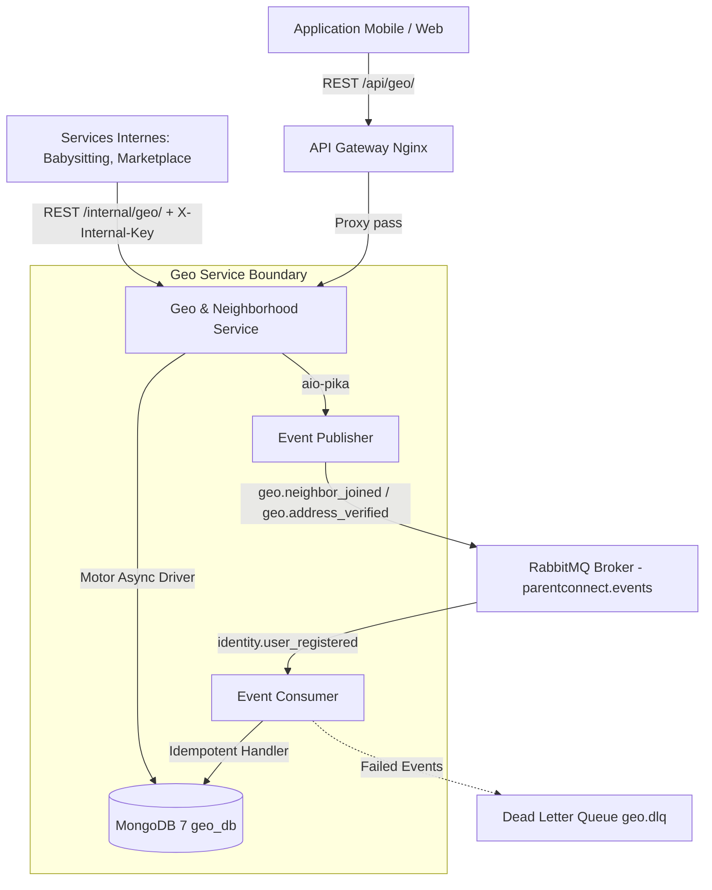

# ParentConnect - Geo & Neighborhood Service

Le **Geo & Neighborhood Service** est le microservice géospatial de la plateforme **ParentConnect**. Il gère la découpe des quartiers, le positionnement flouté et confidentiel des parents, la recherche de proximité pour les services partenaires (*Marketplace*, *Babysitting*, *Events*), les points de rencontre sécurisés ainsi que la vérification d'adresse par les pairs.

---

## Architecture & Flux de Données



---

## Règles d'Or du Microservice

1. **Database-per-service** : Base exclusive `geo_db`, jamais accédée par un autre service.
2. **Aucune clé étrangère vers Identity** : Stockage strict de `user_id` sous forme de chaîne (`str`).
3. **Autonomie au démarrage** : Le microservice valide les JWT localement via sa clé publique (`RS256`) ou secret partagé (`HS256`). Il démarre et fonctionne même si le service Identity est indisponible.
4. **Zéro coordonnée exacte, zéro donnée enfant** : L'adresse exacte n'est **jamais stockée** en base. Les coordonnées sont floutées côté serveur (~200m).
5. **Protection Anti-Moyennage (Floutage Stable HMAC)** : Le décalage aléatoire est dérivé d'un hash HMAC du `user_id` et d'un sel serveur (`BLUR_SALT`). Un parent enregistrant sa position plusieurs fois conserve le même décalage spatial, rendant impossible toute attaque par moyennage statistique.
6. **Protection Anti-Triangulation (/nearby)** : Sur l'endpoint public `/nearby`, les distances sont arrondies aux 100 mètres les plus proches (ex. 200m, 300m) et les coordonnées sont masquées. Seuls les endpoints internes protégés par `X-Internal-Key` reçoivent la distance exacte en mètres.

---

## Tableau Récapitulatif des Endpoints

| Méthode | Chemin | Accès / Authentification | Description |
| :--- | :--- | :--- | :--- |
| `GET` | `/health` | Public | Liveness probe (HTTP 200) |
| `GET` | `/ready` | Public | Readiness probe (vérifie Mongo & RabbitMQ) |
| `GET` | `/metrics` | Public | Métriques Prometheus (`prometheus-fastapi-instrumentator`) |
| `POST` | `/api/geo/neighborhoods` | `Bearer JWT` (Rôle `ADMIN`) | Création d'un quartier avec polygone GeoJSON |
| `GET` | `/api/geo/neighborhoods/{id}` | `Bearer JWT` | Détails d'un quartier |
| `GET` | `/api/geo/neighborhoods/by-point` | `Bearer JWT` | Détection de quartier contenant un point (`$geoIntersects`) |
| `GET` | `/api/geo/neighborhoods` | `Bearer JWT` | Liste paginée des quartiers |
| `POST` | `/api/geo/locations` | `Bearer JWT` | Enregistrement de position avec floutage serveur et auto-détection |
| `GET` | `/api/geo/locations/me` | `Bearer JWT` | Consultation de la position floutée enregistrée |
| `GET` | `/api/geo/nearby` | `Bearer JWT` | Recherche de parents proches anonymisés (distance arrondie à 100m) |
| `GET` | `/api/geo/users/{id}/proximity` | `Bearer JWT` | Distance Haversine entre l'appelant et un parent cible |
| `POST` | `/api/geo/addresses/verify` | `Bearer JWT` | Lancement d'une demande de vérification d'adresse |
| `POST` | `/api/geo/addresses/{id}/validate` | `Bearer JWT` | Validation par un voisin (seuil configurable $\to$ statut `verified`) |
| `POST` | `/api/geo/circles` | `Bearer JWT` | Création / mise à jour d'un cercle de confiance (`close`, `neighborhood`, `all`) |
| `GET` | `/api/geo/circles` | `Bearer JWT` | Liste des cercles de confiance de l'utilisateur |
| `GET` | `/api/geo/meeting-points` | `Bearer JWT` | Points de rencontre sûrs d'un quartier (`park`, `daycare`, `town_hall`) |
| `POST` | `/api/geo/meeting-points` | `Bearer JWT` (Rôle `ADMIN`) | Création d'un point de rencontre sûr |
| `GET` | `/internal/geo/users-within` | `X-Internal-Key` (Temps constant) | Recherche inter-services avec distances exactes en mètres |
| `GET` | `/internal/geo/distance` | `X-Internal-Key` (Temps constant) | Calcul de distance directe entre deux utilisateurs |

---

## Décisions Techniques & Justifications

### 1. Pourquoi MongoDB et l'index 2dsphere ?
- **Opérateurs géospatiaux natifs** : MongoDB supporte le standard GeoJSON (RFC 7946). L'opérateur `$geoNear` permet une agrégation en une seule passe pour trier par distance géodésique sur la sphère terrestre tout en appliquant des filtres (`$limit`, pagination, exclusion d'utilisateur).
- **Index partiel (`partialFilterExpression`)** : Lorsqu'un utilisateur est créé par l'événement `identity.user_registered`, son document dans `user_locations` ne contient pas encore de champ `location`. L'index MongoDB `2dsphere` rejette les valeurs `null`. L'index partiel `{"location": {"$exists": true}}` garantit l'intégrité sans duplication ni erreur d'indexation.

### 2. Pourquoi le Floutage Stable HMAC ?
- Dans les applications géolocalisées classiques, un floutage aléatoire calculé à chaque requête permet à un attaquant d'effectuer de multiples requêtes et de calculer la moyenne des positions reçues (*law of large numbers*), révélant la position exacte.
- En dérivant le décalage géodésique $(\Delta \text{lng}, \Delta \text{lat})$ de manière déterministe via $\text{HMAC-SHA256}(\text{BLUR\_SALT}, \text{user\_id})$, un utilisateur conserve un décalage spatial stable et borné à $200\text{ m}$.

### 3. Pourquoi RS256 par défaut vs HS256 ?
- **RS256 (Recommandé en production)** : Algorithme asymétrique. Le service Identity possède la clé privée et signe les tokens. Le `geo-service` ne possède que la **clé publique** (`JWT_PUBLIC_KEY`). Même en cas de compromission du service Geo, aucune émission frauduleuse de tokens n'est possible.
- **HS256** : Clé symétrique partagée (`JWT_SECRET`), conservée pour des environnements de développement légers ou des tests unitaires rapides.

### 4. RabbitMQ : Idempotence et Reconnexion Robuste
- **Exchange Topic** : `parentconnect.events`.
- **Idempotence** : Tout événement consommé (`identity.user_registered`) enregistre son `event_id` dans la collection `processed_events`. En cas de duplicate delivery réseau, l'erreur d'unicité `DuplicateKeyError` est interceptée et le message est acquitté immédiatement sans ré-exécuter le traitement.
- **Dead Letter Queue (DLQ)** : Si un message est malformé ou échoue définitivement, il est routé vers `geo.dlq` via l'exchange direct `parentconnect.dlx`.
- **Résilience** : `aio_pika.connect_robust` avec tentative en arrière-plan. Si RabbitMQ démarre après le service ou subit un redémarrage, l'API FastAPI répond toujours sans bloquer les workers HTTP.

---

## Installation & Lancement

### Avec Docker Compose (Recommandé)

```bash
cd geo-service
docker-compose up --build
```

- **API Geo** : `http://localhost:8006/api/geo/docs`
- **Documentation OpenAPI** : `http://localhost:8006/api/geo/openapi.json`
- **RabbitMQ Management** : `http://localhost:15672` (guest / guest)
- **MongoDB** : `localhost:27017`

### Lancement Local (Développement)

```bash
cd geo-service

# 1. Installer les dépendances
pip install -r requirements.txt

# 2. Configurer les variables d'environnement
cp .env.example .env

# 3. Lancer l'application Uvicorn
uvicorn app.main:app --host 0.0.0.0 --port 8000 --reload
```

---

## Peuplement Initial (Seed)

Le script insère 4 quartiers réalistes de Tunis (Lafayette, Mutuelleville, Centre Ville, Ennasr 2), 20 parents avec positions floutées, des points de rencontre et des cercles de confiance :

```bash
python scripts/seed.py
```

---

## Exécution des Tests

La suite de tests automatisée couvre les tests unitaires (mathématiques, floutage, Haversine), d'intégration MongoDB (`$geoNear`, `$geoIntersects`), de sécurité (JWT, RBAC, API Key) et d'idempotence d'événements.

```bash
pytest -v
```

---

## Exemples de Requêtes cURL

### 1. Enregistrer sa position (Parent)

```bash
curl -X POST http://localhost:8000/api/geo/locations \
  -H "Authorization: Bearer <TOKEN_JWT>" \
  -H "Content-Type: application/json" \
  -d '{"lng": 10.1815, "lat": 36.8065}'
```

### 2. Rechercher les parents proches (/nearby)

```bash
curl -X GET "http://localhost:8000/api/geo/nearby?lng=10.1815&lat=36.8065&radius=2000" \
  -H "Authorization: Bearer <TOKEN_JWT>"
```

### 3. Recherche inter-services (Marketplace / Babysitting)

```bash
curl -X GET "http://localhost:8000/internal/geo/users-within?lat=36.8065&lng=10.1815&radius=3000" \
  -H "X-Internal-Key: parentconnect-internal-geo-secret-key-32ch"
```
